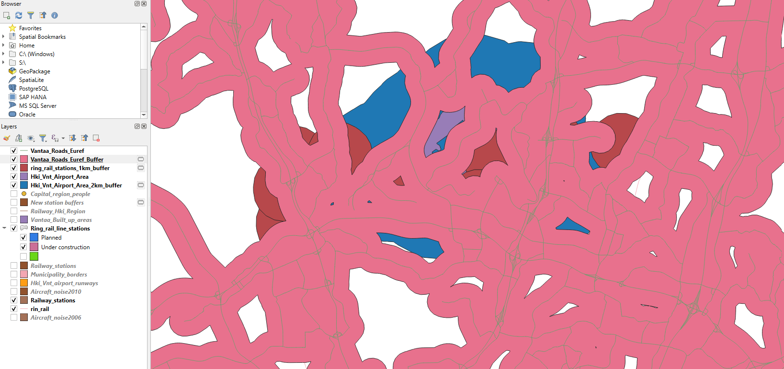
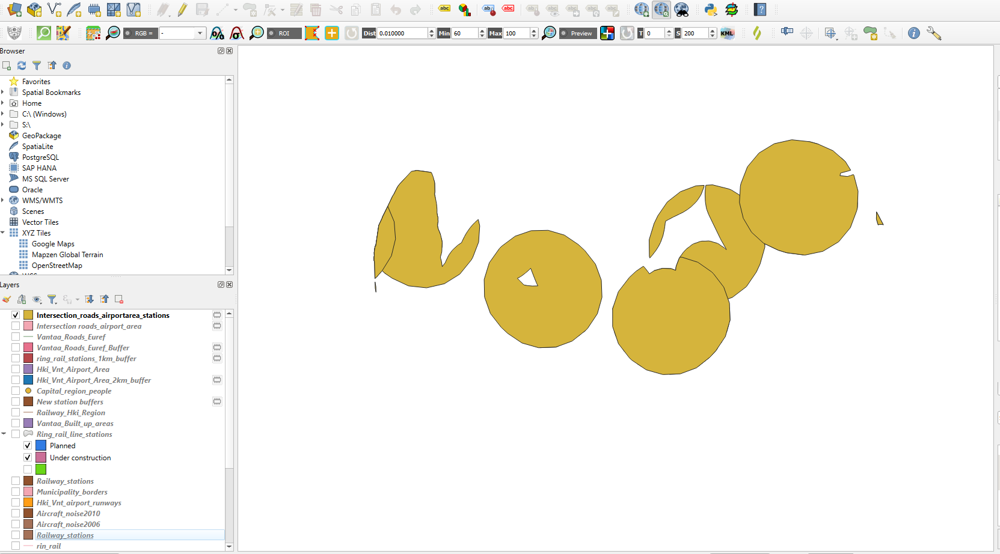
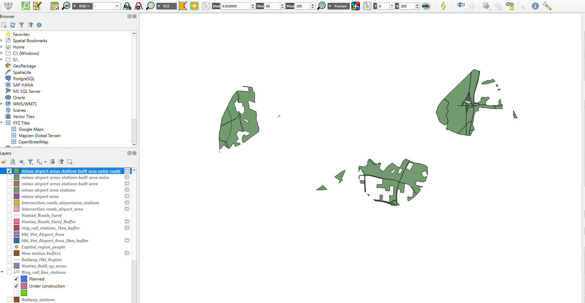

### Fundamentals of Geographic Information Systems (GIS)

# Exercise 4: Vector buffer & overlay analysis

*Adapted from the EEB-313 course (Helsinki University) by Rowan van der Kaaden and Jonathon Taylor* 

## OVERVIEW & PURPOSE

A key part of urban planning and geospatial analysis is identifying suitable locations for new developments. For example, you may want to look for suitable locations for schools by school level population and available land. If you work for a business, you may want to identify areas that could be good candidates to open a new store, by residents, their demographics, and connection to transport services. GIS can help support these decisions.

The Ring Rail Line, also known as “Kehärata”, is a railway line that was opened in 2015 in the Helsinki capital region. The new rail route created a connection between Helsinki-Vantaa Airport and the Helsinki region commuter traffic network by joining the existing Vantaankoski and Main line branches. The approximately 18-kilometer-long Ring Rail line connects to the current rail network at the Vantaankoski and Hiekkaharju stations and the track between Viinikkala and Ruskeasanta goes in an underground tunnel.

For the 2015 opening, altogether five new stations were constructed at Leinelä, Helsinki-Vantaa Airport, Aviapolis, Kivistö and Vehkala. Reservations were also made for four additional stations at Petas, Viinikkala, Ruskeasanta and Lapinkylä to be built later in the second phase. Out of these, the Aviapolis and Airport stations are located underground. Similarly, the reserved stations of Ruskeasanta and Viinikkala would be located underground.

The Ring Rail line improves the accessibility of the airport area and the suburbs along the route, cut down the journey times for over 12 million airport passengers per annum and it was also estimated to create employment for over 60 000 people.

*Legend in English: Pintarata = Overground, Tunneli = tunnel, Asema = station, Asemavaraus = station reservation, Nykyiset asemat = Current stations, Hämeenlinnanväylän parannus = improvement of Hämeenlinnanväylä*

## OBJECTIVES
This exercise consists of three main objectives:
- Gather and prepare data of the ring rail line for processing
- Use the gathered ring rail line data and provided data to answer questions about the impact of the ring rail line and the airport on the surrounding residents
- Find an optimal location for a new Airport Hotel & Congress Center to the Helsinki-Vantaa Airport area based on accessibility

To complete these you will put the following main skills to use:
- Data gathering and processing
- Buffer analysis
- Overlay analysis

## DATA USED

- Helsinki Regional Transport Authority
	- https://public-transport-hslhrt.opendata.arcgis.com/
	- Used as a basis for the Railway data

## Completion

Complete the exercise and submit a short report containing at least the following:

1. Maps of the outcome of the exercise

	- Remember: all maps should have a legend, a scale bar and a north arrow

	- Use the tips from the Crash Course to improve your map

2. A short reflection (200-300 words) on this exercise and your map

## EXERCISE PHASES

### Part 1: The ring rail line visualization
#### 1.1: Getting the data
1. Download 4_Exercise_data from the [Github repository](https://github.com/Tampere-University-Urban-Physics/fundamentals-of-gis/tree/master/Data), save it in a folder for this exercise, and add it to your QGIS project. 
	- Go through the data, what does it describe? What order of layers would be good to work with?
	- **Hint**. This exercise uses a lot of layers. You can help yourself by clearly naming the new layers you create, and keeping notes of what each layer includes. This is good practice for future work too.

2. We need to have the Ring Rail Line in geospatial format. HRI offers easy access to open data sources between the cities of Helsinki, Espoo, Vantaa and Kauniainen. You can often find data on the Helsinki-Region Transport’s public transport lines from 2021-2022 on HSL’s website. https://public-transport-hslhrt.opendata.arcgis.com/datasets/HSLHRT::hsln-linjat-4/explore?location=60.470090%2C25.365467%2C9.39
	- However, because HSL has had a tendency to remove the data, or move it, you can find the HSL data for the ring rail in the downloaded exercise data, HSL%3An_linjat.shp

3. Add HSL%3An_linjat.shp to your QGIS project and inspect the features, what do you notice? 
	- There are still duplicate entries for the Ring Rail Line and there are other entries we do not need and are in the way
	- We want to end up with only the Ring Rail Line. Go through the attribute table selecting rows and find which entry describes the full ring Rail Line. Export this (Exercise 3, step 4) this to a new layer. You can remove the original layer by right-clicking it and selecting Remove Layer.

#### 1.2: Making a map visualization of the new ring rail line
4. For visualization purposes we want to have underground part of the rail as a separate segment. You can do this by splitting the ring rail line feature you exported into multiple features. 
	 We can use Google Satellite imagery (Hint: Exercise 2) and the overview map of the ring rail line to find the places where we need to split the ring rail line

	- You might want to change the symbology of your ring rail line to make it more visible for editing
	- Select your Ring Rail Line layer, toggle on editing, and navigate to Edit > Edit Geometry > Split features
		- How to Split and Merge Lines in QGIS: https://www.youtube.com/watch?v=vLL4hdDO1zU
	- Split the line into sections for overground and underground track. This requires zooming in and seeing from the satellite imagery where the track is above ground, and where is is below ground.
		- Once you have split the track, create a field which describes whether the track is over- or underground so we can use symbology to differentiate these (Attribute table > New Field). This can be either a text (string) or an integer where 0 is underground and 1 is overground.
	- Don't forget to save your edits and toggle off editing

5. Now look at the ring_rail_line_stations and railway_stations layers. For the visualization we would only like to have the stations that are part of the ring rail line, and have them seperated by pre-existing, new, and planned stations. 
	- Let's start by removing the stations that are not part of the ring rail line. Toggle on editing for the railway_stations layer, select the stations we want to remove, and use *Delete Selected* in the editing toolbar (Hint: Exercise 2, section 1.3, step 4) (Don't forget to save edits and toggle off editing). **Hint** it is easier to see these stations if you turn off the Google Maps layer.
	- Now take a look at the attribute table of the ring_rail_line_stations layer, as you can see there is already a field for which stations are new or planned, so we can use symbology to differentiate these. In this case we can use a Categorized symbology to differentiate their Stage (Planned vs Under construction).
	- Optionally: Convert the train stations from polygons to points: https://docs.qgis.org/3.16/en/docs/user_manual/processing_algs/qgis/vectorgeometry.html#centroids
		- In this scase, points scale better, are easier to edit, and easier to add labels to

6. Make a visualization to show the ring rail line. Show on your map: where the railway is underground, which stations are new and whatever else you find convenient. 
	- Use categorized symobology to show the different types of railway (underground vs overground) and stations
	- Don't forget to add a basemap for reference (**hint:** Use one that contrasts with the data)
	- Only include the information you want to communicate (e.g. the lines and stations).
	- Optionally you can add labels to the stations either by digitizing or editing one of the ring rail line features (there’s multiple features with same information). The dataset still contains some extra features, you can keep them for visualization or delete them, as you wish. You can see the route in the Ring Rail Line Brochure PDF (see Moodle).

---

### Part 2: The ring rail line analysis
#### 2.1: Analyzing the effects on the people in the study area
As already mentioned, the Ring Rail line improves the commuter traffic network and accessibility of the suburbs along the track, but how does this show on real numbers?

1. Find out how many are affected by the new stations by calculating how many people live within a radius of 1 kilometer of them, and the new and planned stations combined.
	- You can do this by doing a buffer analysis using the ring_rail_line_stations and capital_region_people data (which gives a count of residents in the area). Now is a good time to open the Moodle quiz to get the answers to these questions.
	- Open the *Buffer* tool from the *Processing Toolbox*
	- Make a 1km buffer around the ring_rail_line_stations
		- To only make a buffer around the planned stations, select those stations and use the *Selected features only* function in the *Buffer* tool
	- Don't forget to make the temporary layers from the buffer permanent
	- Use *Select by Location* to select the entries from the capital_region_people data that intersect with the buffers
	- Run *Basic Statistics for Fields* (from the *Processing Toolbox*) to get the total amount of residents living within the buffer (Input layer: Capital_region_people, selected feature only, Field to calculate: ASYHT(Persons in total in the building))
		- Look the output log for the SUM output, this shows the total amount
	- Repeat the same steps for the new and planned stations combined.

The Ring Rail Line is likely to increase the attraction for the real estate in the nearby area. This, however, will also raise the question of the noise levels caused by the Aircraft traffic around the Helsinki-Vantaa Airport. Thanks to new improved technology the aircraft noise levels have slightly dropped in recent years.

2. Find out how many people approximately live :
	- ...in or above the 50dB zone in 2006? And 
	- ...in or above the 55dB zone in 2010?
	- This time you don't need to create a buffer, as the dB zones already exist
		- **Hint**: Use the attribute table to select the relevant dB levels
		- **Hint**: Use *Selected features only* in *Select by location*

*Tip : For the Capital_region_people layer field name metadata, see Appendix in Exercise 4 instructions*

---

### Part 3: Planning a new airport hotel & congress center near the ring rail line
1. You work in a team that is supposed to find an optimal location for a new Airport Hotel & Congress Center to the Helsinki-Vantaa Airport area based on accessibility. Your task is to follow the given requirements and make a map visualization of the area(s) to be shown at the company meeting of where the new Hotel & Congress center could possibly be located.

| **The requirements are as follows** |
|:---|
|- The Hotel & Congress Center has to be located within the maximum **distance of 2 kilometers from the Airport area** (but not inside it the airport area itself) |
|- The Hotel & Congress Center has to be easily accessible, thus located **within the radius of 1 kilometer from Ring Rail Line stations** |
|- It has to be **within the radius of 500 meters from the road network**. |
|- The Hotel & Congress Center has to be **outside the ≥ 55 dB noise zones** caused by the airport traffic. |
|- The Hotel & Congress Center **cannot be built on already built up areas**. |
|- The Hotel & Congress Center requires **at least 5000 m2 of free building space**. |

This sounds complicated, but can be done step by step, by creating buffers around the airport area, ring rail line stations, and road network, setting the distance based on the requirements. **Hint**: When creating buffers, don't forget to make your outputs permanent in between processing. You can make your life a lot easier if you clearly name the layers that you create.

2. First, let's make the buffer around the airport area layer (Hki_Vnt_Airport_Area) using the Buffer tool. Note: In the buffer tool, you can switch the units to km if you want.

3. Next, make the buffer around the Ring Rail Line stations (both planned and under construction). 

4. Then, make the buffer around the roads. **Hint** You can select dissolve the result of the roads buffer to make future steps easier. Dissolve removes boundaries between adjacent polygons or lines that share the same attribute value. You might end up with something that looks like below, depending on the order of your layers and symbologies.
	
 

5. For roads, airport area, and ring stations, you are looking for where the layers overlap. Use the *Intersection*  tool to combine intersect these buffers to get the areas which are only within 2km of the airport area, within a 1km radius from the stations, and within 500m from the road network. 
	- You have to run this intersect with two buffers first, then run the output of that with the final buffer to get the desired result.

*Your result from using the Intersection tool could look like this*

6. Now we need to remove the areas that are not suitable from this layer, namely the airport area itself, the stations themselves, the roads themselves, the 55 dB noise zone, and the build up areas. We can do this using the *Difference* tool, read its description, what does it do? In short, it outputs the parts of the input layer that fall outside the overlay layer. We need to run this for all our areas that we do not want to build the hotel step by step, like we did with the intersect tool before.
		- **Hint** Use *Selected features only* again where necessary (the aircraft noise goes from 50dB, and you want to be selecting and differencing those only equal to or above 55dB)
		-**Hint** The roads are polylines, not polygons. Draw a new buffer around the roads with an estimated width of a road to be able to difference them

*Your result from using the differencing tool could look like this*

7. Now we should have some kind of idea of the areas that fit most of criteria. The catch? If you use the identify tool or attribute table to select polygons, you will notice that some polygons that look seperate are, in fact, the same polygon that we have split when using the difference tool. This means we can't yet eliminate areas that are too small to build on. Use the Multipart to Singlepart- geoprocessing tool to convert these to seperate polygons. We want to do this to be able to calculate the total area of the combined land. 

8. Once we have the final suitable areas we need to determine which have at least 5000m2 of free building space. You can use the *Extract by Expression* tool (Hint: Crash Course, section 2.1).

#### 4.: Finalising your maps

1. Make your final map of the suitable areas for the new airport hotel & congress center. Try to make the map as clear and informative as possible and insert the finished map with all the necessary map elements to your current layer and its features. Also finalise your map of the ring rail and the stations.
  - **Hint** Just include the layers necessary to communicate the results for the maps we want (the ring rail map and the hotel location map).
  - **Hint** Rename the layers so that they have names that a map reader can understand clearly
  - **Hint** Remember all the elements of a good map!

<!--stackedit_data:
eyJkaXNjdXNzaW9ucyI6eyIyTXFpRU16M2ZuTXNxa3NPIjp7In
N0YXJ0Ijo4ODU5LCJlbmQiOjg5NDAsInRleHQiOiJOb3cgaXMg
YSBnb29kIHRpbWUgdG8gb3BlbiB0aGUgTW9vZGxlIHF1aXogdG
8gZ2V0IHRoZSBhbnN3ZXJzIHRvIHRoZXNlIHF1ZXN0aW9u4oCm
In0sIkQ1RVdoMlJEcnNYOUFJeHAiOnsic3RhcnQiOjQxMiwiZW
5kIjo0MzUsInRleHQiOiJzY2hvb2wgbGV2ZWwgcG9wdWxhdGlv
biJ9LCJrd3lURlpxNk9KRmhkWHR6Ijp7InN0YXJ0IjozMDc1LC
JlbmQiOjMxNDcsInRleHQiOiItIFJlbWVtYmVyOiBhbGwgbWFw
cyBzaG91bGQgaGF2ZSBhIGxlZ2VuZCwgYSBzY2FsZSBiYXIgYW
5kIGEgbm9ydGggYXJyb3cifSwiRGNNajh1SXRSbW1Qc3AzMiI6
eyJzdGFydCI6MzM2OSwiZW5kIjozODkxLCJ0ZXh0IjoiMS4gRG
93bmxvYWQgNF9FeGVyY2lzZV9kYXRhIGZyb20gdGhlIFtHaXRo
dWIgcmVwb3NpdG9yeV0oaHR0cHM6Ly9naXRodWIuY29tL1Rhbe
KApiJ9LCJOUnFZVXpyMXRjT2JyTnRrIjp7InN0YXJ0IjozODkz
LCJlbmQiOjQ0NzMsInRleHQiOiIyLiBXZSBuZWVkIHRvIGhhdm
UgdGhlIFJpbmcgUmFpbCBMaW5lIGluIGdlb3NwYXRpYWwgZm9y
bWF0LiBIUkkgb2ZmZXJzIGVhc3kgYWNj4oCmIn0sInlyQ0NUOX
VpUnJuaEg2ejgiOnsic3RhcnQiOjQ0ODIsImVuZCI6NDUwMCwi
dGV4dCI6IkhTTCUzQW5fbGluamF0LnNocCJ9LCJmNW9WMVdud0
o3Y3hBVng4Ijp7InN0YXJ0Ijo0ODk4LCJlbmQiOjQ5ODAsInRl
eHQiOiJZb3UgY2FuIHJlbW92ZSB0aGUgb3JpZ2luYWwgbGF5ZX
IgYnkgcmlnaHQtY2xpY2tpbmcgaXQgYW5kIHNlbGVjdGluZyBS
ZW1vdmUgTGF54oCmIn0sInp5RFFXR1NzaGZScjFPMUkiOnsic3
RhcnQiOjU1MDEsImVuZCI6NTYwOSwidGV4dCI6Ii0gU2VsZWN0
IHlvdXIgUmluZyBSYWlsIExpbmUgbGF5ZXIsIHRvZ2dsZSBvbi
BlZGl0aW5nLCBhbmQgbmF2aWdhdGUgdG8gRWRpdCA+IEXigKYi
fSwiRFBIODZ6aVo3SVRsbVJDayI6eyJzdGFydCI6NjQ3NCwiZW
5kIjo2ODY0LCJ0ZXh0IjoiZXQncyBzdGFydCBieSByZW1vdmlu
ZyB0aGUgc3RhdGlvbnMgdGhhdCBhcmUgbm90IHBhcnQgb2YgdG
hlIHJpbmcgcmFpbCBsaW5lLiBUb+KApiJ9LCJBSlA0T01Pd25G
ZTJSWjF5Ijp7InN0YXJ0Ijo3NDM2LCJlbmQiOjc2MDEsInRleH
QiOiI2LiBNYWtlIGEgdmlzdWFsaXphdGlvbiB0byBzaG93IHRo
ZSByaW5nIHJhaWwgbGluZS4gU2hvdyBvbiB5b3VyIG1hcDogd2
hlcmUgdGhl4oCmIn0sImdMbE82MEZUNjE3Y0ZyRXkiOnsic3Rh
cnQiOjc3MTQsImVuZCI6NzgwOCwidGV4dCI6Ii0gRG9uJ3QgZm
9yZ2V0IHRvIGFkZCBhIGJhc2VtYXAgZm9yIHJlZmVyZW5jZSAo
KipoaW50OioqIFVzZSBvbmUgdGhhdCBjb250cmFzdHPigKYifS
wiMzlqa3MyMWtWVGdYekZoRCI6eyJzdGFydCI6OTA1NSwiZW5k
Ijo5MTk2LCJ0ZXh0IjoiLSBUbyBvbmx5IG1ha2UgYSBidWZmZX
IgYXJvdW5kIHRoZSBwbGFubmVkIHN0YXRpb25zLCBzZWxlY3Qg
dGhvc2Ugc3RhdGlvbnMgYW5k4oCmIn0sIkpIOHBRSzBmMzM5WU
M4ZTYiOnsic3RhcnQiOjkzNTksImVuZCI6OTM2OCwidGV4dCI6
ImludGVyc2VjdCJ9LCJZZFhNRTdqWW5NSWlueTRjIjp7InN0YX
J0Ijo5NTE3LCJlbmQiOjk2MzcsInRleHQiOiIoSW5wdXQgbGF5
ZXI6IENhcGl0YWxfcmVnaW9uX3Blb3BsZSwgc2VsZWN0ZWQgZm
VhdHVyZSBvbmx5LCBGaWVsZCB0byBjYWxjdWxhdGU64oCmIn0s
ImNhWVNFazZ4enhWSUpJaHkiOnsic3RhcnQiOjk3MTEsImVuZC
I6OTc3NywidGV4dCI6Ii0gUmVwZWF0IHRoZSBzYW1lIHN0ZXBz
IGZvciB0aGUgbmV3IGFuZCBwbGFubmVkIHN0YXRpb25zIGNvbW
JpbmVkLiJ9LCJ4eWlWc1ZDa3NiUG9KN0haIjp7InN0YXJ0Ijox
MDEwNiwiZW5kIjoxMDQ1NywidGV4dCI6IjIuIEZpbmQgb3V0IG
hvdyBtYW55IHBlb3BsZSBhcHByb3hpbWF0ZWx5IGxpdmUgOlxu
XHQtIC4uLmluIG9yIGFib3ZlIHRoZSA1MGRCIHpvbuKApiJ9LC
JHaUFtaGJJQXppeTZXa1M3Ijp7InN0YXJ0IjoxMTcyNSwiZW5k
IjoxMjA5OSwidGV4dCI6IlRoaXMgc291bmRzIGNvbXBsaWNhdG
VkLCBidXQgY2FuIGJlIGRvbmUgc3RlcCBieSBzdGVwLCBieSBj
cmVhdGluZyBidWZmZXJzIGFyb3XigKYifSwiNXN5d2txa0VnRW
NoTmJhOCI6eyJzdGFydCI6MTIyODEsImVuZCI6MTIzNzksInRl
eHQiOiIzLiBOZXh0LCBtYWtlIGEgMWttIGJ1ZmZlciBhcm91bm
QgdGhlIFJpbmcgUmFpbCBMaW5lIHN0YXRpb25zIChib3RoIHBs
YW5uZWQgYW5k4oCmIn0sInJxTURDTzR6aElCR0pJc0giOnsic3
RhcnQiOjEyOTc1LCJlbmQiOjEyOTg3LCJ0ZXh0IjoiSW50ZXJz
ZWN0aW9uIn0sIlhpTFI4TTBpY2tRSlpCankiOnsic3RhcnQiOj
EzMTc0LCJlbmQiOjEzMzA3LCJ0ZXh0IjoiLSBZb3UgaGF2ZSB0
byBydW4gdGhpcyBpbnRlcnNlY3Qgd2l0aCB0d28gYnVmZmVycy
BmaXJzdCwgdGhlbiBydW4gdGhlIG91dHB1dCBvZuKApiJ9LCI5
NHFxZlBMc0VGV0dnd3hSIjp7InN0YXJ0IjoxMzU4NywiZW5kIj
oxMzcxMSwidGV4dCI6Im5hbWVseSB0aGUgYWlycG9ydCBhcmVh
IGl0c2VsZiwgdGhlIHN0YXRpb25zIHRoZW1zZWx2ZXMsIHRoZS
Byb2FkcyB0aGVtc2VsdmVzLOKApiJ9LCIybFM4QzJJYnEzQWdS
dHc1Ijp7InN0YXJ0IjoxMzg4MiwiZW5kIjoxNDAxNiwidGV4dC
I6IldlIG5lZWQgdG8gcnVuIHRoaXMgZm9yIGFsbCBvdXIgYXJl
YXMgdGhhdCB3ZSBkbyBub3Qgd2FudCB0byBidWlsZCB0aGUgaG
90ZWwgc3TigKYifSwiZkFiRFZyUEFKM3JWWkd0TCI6eyJzdGFy
dCI6MTUyODUsImVuZCI6MTU5MTcsInRleHQiOiIjIyMjIDQuOi
BGaW5hbGlzaW5nIHlvdXIgbWFwc1xuXG4xLiBNYWtlIHlvdXIg
ZmluYWwgbWFwIG9mIHRoZSBzdWl0YWJsZSBhcmVhcyBmb3LigK
YifX0sImNvbW1lbnRzIjp7ImF3dzhMM3FnMHpYR0RNQ1YiOnsi
ZGlzY3Vzc2lvbklkIjoiMk1xaUVNejNmbk1zcWtzTyIsInN1Yi
I6ImdoOjQwMzA0Nzg4IiwidGV4dCI6IlZlcmlmeSB0aGF0IHRo
aXMgcXVpeiBpcyBjb3JyZWN0IiwiY3JlYXRlZCI6MTc3NjkzOT
YyMzY4Nn0sInlGZzZrU0JkZGJpbWFOZFUiOnsiZGlzY3Vzc2lv
bklkIjoiRDVFV2gyUkRyc1g5QUl4cCIsInN1YiI6ImdoOjQwMz
A0Nzg4IiwidGV4dCI6IlVuY2xlYXIiLCJjcmVhdGVkIjoxNzk0
MjI0NTE4NzI3fSwid0pEOTd6YjlhdUI4VUtwZSI6eyJkaXNjdX
NzaW9uSWQiOiJrd3lURlpxNk9KRmhkWHR6Iiwic3ViIjoiZ2g6
NDAzMDQ3ODgiLCJ0ZXh0IjoiVXBkYXRlIiwiY3JlYXRlZCI6MT
c5NDIyNDY4NzE3M30sIkZlaXhnR2dUOTV1Z01qaVYiOnsiZGlz
Y3Vzc2lvbklkIjoiRGNNajh1SXRSbW1Qc3AzMiIsInN1YiI6Im
doOjQwMzA0Nzg4IiwidGV4dCI6IkFkZCBpbnN0cnVjdGlvbnMg
b24gaG93IHRvIHVzZSBncm91cHMgdG8gb3JnYW5pemUgZGF0YS
4iLCJjcmVhdGVkIjoxNzk0MjI1MDc1ODIzfSwiQlQ3OUJSNjZ2
OWh4emVFVCI6eyJkaXNjdXNzaW9uSWQiOiJEY01qOHVJdFJtbV
BzcDMyIiwic3ViIjoiZ2g6NDAzMDQ3ODgiLCJ0ZXh0IjoiYW5k
IGEgaGludCB0byBhZGQgYSBiYXNlbWFwIHdoaWxlIHlvdSdyZS
B3b3JraW5nIHRvIG1ha2UgaXQgZWFzeSB0byBzZWUgd2hlcmUg
dGhpbmdzIGFyZSwgYW5kIHdoZXRoZXIgdGhlIENSUyBhbGlnbn
MiLCJjcmVhdGVkIjoxNzk0MjI1Mjg4NzExfSwidTJRbzdyYTdr
N0ZmOFVheiI6eyJkaXNjdXNzaW9uSWQiOiJOUnFZVXpyMXRjT2
JyTnRrIiwic3ViIjoiZ2g6NDAzMDQ3ODgiLCJ0ZXh0IjoiRGF0
YSBpcyBieSBkZWZhdWx0IGluIHRoZSB6aXAsIHdoaWNoIGlzIH
Vud2FudGVkIGFzIHdlIHdhbnQgc3R1ZGVudCB0byBsZWFybiBo
b3cgdG8gY29sbGVjdCBkYXRhIHRoZW1zZWx2ZXMuIFNvIGF0IG
xlYXN0IHdlIHNob3VsZCBtYWtlIHRoaXMgYSBzZXBhcmF0ZSBk
b3dubG9hZCBzbyB0aGF0IHN0dWRlbnRzIGZpcnN0IGdvIHRvIE
hTTCBsaW5rLCBha2EgbWFrZSB0aGUgSFNMIG9wdGlvbiBlYXNp
ZXIgaW4gdGhlIGZpcnN0IGluc3RhbmNlLiIsImNyZWF0ZWQiOj
E3OTQyMjU2OTIyNDN9LCI1eE8xYlBaaTZqUzQ2VktXIjp7ImRp
c2N1c3Npb25JZCI6Ik5ScVlVenIxdGNPYnJOdGsiLCJzdWIiOi
JnaDo0MDMwNDc4OCIsInRleHQiOiJBbHRob3VnaCB0aGUgSFNM
IGxpbmsgY3VycmVudGx5IGRvZXMgbm90IHdvcmssIHNvIHdlIH
Nob3VsZCBmaXggdGhhdCB0b28gb3IgZmluZCBhbm90aGVyIHBs
YWNlIGluIHRoZSBjb3Vyc2UgdG8gcHJhY3RpY2UgZGF0YSBjb2
xsZWN0aW9uLiIsImNyZWF0ZWQiOjE3OTQyMjU4MzgxNjN9LCJS
aDhadDk2NXNMTml6c2dxIjp7ImRpc2N1c3Npb25JZCI6InlyQ0
NUOXVpUnJuaEg2ejgiLCJzdWIiOiJnaDo0MDMwNDc4OCIsInRl
eHQiOiJGaXggdGhpcyBmaWxlbmFtZSwgc2V0IHRoZSByaWdodC
BleGFtcGxlLiIsImNyZWF0ZWQiOjE3OTQyMjU4NTEzODV9LCIx
S0w1Z01RbVpjTzlKckYwIjp7ImRpc2N1c3Npb25JZCI6ImY1b1
YxV253SjdjeEFWeDgiLCJzdWIiOiJnaDo0MDMwNDc4OCIsInRl
eHQiOiJPciBtb3ZlIHRvIHRoZSBhcmNoaXZlLCBoaW50IGJhY2
sgdG8gdGhlIGdyb3Vwcy4iLCJjcmVhdGVkIjoxNzk0MjI2MDM3
MzY2fSwieVhYWVVNdktpT2l5b0dpTCI6eyJkaXNjdXNzaW9uSW
QiOiJ6eURRV0dTc2hmUnIxTzFJIiwic3ViIjoiZ2g6NDAzMDQ3
ODgiLCJ0ZXh0IjoiU2hvdWxkIHdlIGF0IHNvbWUgcG9pbnQgc2
F5IFwidXNlIHRoZSBzcGxpdCBmZWF0dXJlcyB0b29sXCIsIGFu
ZCB0aGVuIGp1c3QgbWFrZSB0aGVtIHNlYXJjaCBmb3IgaXQgdG
8gaGF2ZSB0aGVtIGxlYXJuIGhvdyB0byBzZWFyY2ggZm9yIHRo
ZXNlIHRvb2xzPyIsImNyZWF0ZWQiOjE3OTQyMjYzMzQ3NDV9LC
IyRXlxbXpFamxHSWdBVHppIjp7ImRpc2N1c3Npb25JZCI6IkRQ
SDg2emlaN0lUbG1SQ2siLCJzdWIiOiJnaDo0MDMwNDc4OCIsIn
RleHQiOiJNYWtlIHRoaXMgYSBsaXR0bGUgbGVzcyBoYW5kIGhv
bGRpbmcsIHRoZXkga25vdyBob3cgdG8gZGVsZXRlIGZlYXR1cm
VzLCBtYWtlIHRoZW0gZmlndXJlIGl0IG91dC4iLCJjcmVhdGVk
IjoxNzk0MjI2NTg2MjA2fSwibk83czB0bXJCRDFiWDNvaSI6ey
JkaXNjdXNzaW9uSWQiOiJBSlA0T01Pd25GZTJSWjF5Iiwic3Vi
IjoiZ2g6NDAzMDQ3ODgiLCJ0ZXh0IjoiTWFrZSB0aGUgb2JqZW
N0aXZlIG9mIHRoaXMgbWFwIGNsZWFyZXIiLCJjcmVhdGVkIjox
Nzk0MjI2NzA0MDc3fSwidE82YWhUTzl3UFhCNjIyTCI6eyJkaX
NjdXNzaW9uSWQiOiJnTGxPNjBGVDYxN2NGckV5Iiwic3ViIjoi
Z2g6NDAzMDQ3ODgiLCJ0ZXh0IjoiQWRkIGEgaGludCBvbiB3aG
VyZSB0byBmaW5kIGEgc3VpdGFibGUgYmFzZW1hcCIsImNyZWF0
ZWQiOjE3OTQyMjY3MTI4NDV9LCI3Uml4Smdnc3hnd1pJb1MyIj
p7ImRpc2N1c3Npb25JZCI6IjM5amtzMjFrVlRnWHpGaEQiLCJz
dWIiOiJnaDo0MDMwNDc4OCIsInRleHQiOiJXaGF0IGlzIHRoZS
BwdXJwb3NlIG9mIHRoaXM/IiwiY3JlYXRlZCI6MTc5NDIyNzMw
NjM4OH0sIjFzZXpROGUzYVRTUGlZS0giOnsiZGlzY3Vzc2lvbk
lkIjoiSkg4cFFLMGYzMzlZQzhlNiIsInN1YiI6ImdoOjQwMzA0
Nzg4IiwidGV4dCI6Ik1ha2UgdGhlbSB0aGluayBhYm91dCB3aG
F0IGludHNlcnNlY3QgaXMgYWdhaW4uIiwiY3JlYXRlZCI6MTc5
NDIyNzM5OTIxMH0sIlVaSHpBOVBFSk4zVFNQdUgiOnsiZGlzY3
Vzc2lvbklkIjoiWWRYTUU3alluTUlpbnk0YyIsInN1YiI6Imdo
OjQwMzA0Nzg4IiwidGV4dCI6IklzIHRoaXMgdG9vIGhhbmRzIG
9uPyBTaG91bGQgd2UgbWFrZSB0aGVtIGZpbmQgdGhlIHJlbGV2
YW50IGZpZWxkIHRoZW1zZWx2ZXM/IiwiY3JlYXRlZCI6MTc5ND
IyNzQ5NTAxMX0sImhQTkp2UmJlNGVhVzVJWmIiOnsiZGlzY3Vz
c2lvbklkIjoiY2FZU0VrNnh6eFZJSkloeSIsInN1YiI6ImdoOj
QwMzA0Nzg4IiwidGV4dCI6IlVuY2xlYXIgdGhhdCB1cCB1bnRp
bCBub3cgd2Ugd2VyZSBqdXN0IHN1cHBvc2VkIHRvIGRvIHRoZS
BwbGFubmVkIHN0YXRpb25zPyIsImNyZWF0ZWQiOjE3OTQyMjc1
NDUzNjB9LCJvdkdpZmRvZXhFVFVNcHAxIjp7ImRpc2N1c3Npb2
5JZCI6IjJNcWlFTXozZm5Nc3Frc08iLCJzdWIiOiJnaDo0MDMw
NDc4OCIsInRleHQiOiJwbGFubmVkIGFuZCB1bmRlciBjb25zdH
J1Y3Rpb24gYW5zd2VyIGlzIGNvcnJlY3QgaW4gbW9vZGxlIiwi
Y3JlYXRlZCI6MTc5NDIyNzYxMzIxNH0sIkZLRjE5YURYSkMzdW
dBMHgiOnsiZGlzY3Vzc2lvbklkIjoiMk1xaUVNejNmbk1zcWtz
TyIsInN1YiI6ImdoOjQwMzA0Nzg4IiwidGV4dCI6IlBsYW5uZW
QgaXMgYWxzbyBjb3JyZWN0IiwiY3JlYXRlZCI6MTc5NDIyNzc2
MzQzOX0sIjFPWDJ2RHdyd0ZsdWVrSlIiOnsiZGlzY3Vzc2lvbk
lkIjoieHlpVnNWQ2tzYlBvSjdIWiIsInN1YiI6ImdoOjQwMzA0
Nzg4IiwidGV4dCI6IkNvbmZpcm1lZCB0aGF0IHRoZSBtb29kbG
UgcXVpemVzIGZvciB0aGVzZSBhcmUgYWxzbyBjb3JyZWN0Iiwi
Y3JlYXRlZCI6MTc5NDIyODEwODc0NX0sIjBDRmJPNXJ2dlZvSW
dVZlkiOnsiZGlzY3Vzc2lvbklkIjoiR2lBbWhiSUF6aXk2V2tT
NyIsInN1YiI6ImdoOjQwMzA0Nzg4IiwidGV4dCI6IkFkZCBhIG
5vdGUgdG8ga2VlcCB0aGUgaW5zdHJ1Y3Rpb25zIG9uIHRoZSBz
aWRlLCBmb3IgZXhhbXBsZSBvbiBhIHBpZWNlIG9mIHBhcGVyLC
BhbmQgY3Jvc3MgdGhlbSBvZmYgYXMgeW91IGdvLiIsImNyZWF0
ZWQiOjE3OTQyMjgzMjM1Nzh9LCJCeDJrYjFkZDJkZW5iaWs2Ij
p7ImRpc2N1c3Npb25JZCI6IjVzeXdrcWtFZ0VjaE5iYTgiLCJz
dWIiOiJnaDo0MDMwNDc4OCIsInRleHQiOiJDaGFuZ2UgdGhpcy
B0byBpbnN0cnVjdCB0byB1c2UgdGhlIGJ1ZmZlciBtYWRlIGVh
cmxpZXIuIiwiY3JlYXRlZCI6MTc5NDIyODMzNzY3M30sIjRWVE
5paWE3anRwZzhWblkiOnsiZGlzY3Vzc2lvbklkIjoicnFNRENP
NHpoSUJHSklzSCIsInN1YiI6ImdoOjQwMzA0Nzg4IiwidGV4dC
I6Ikxlc3MgaGFuZHMgb24sIG1ha2UgdGhlbSBmaWd1cmUgb3V0
IHdoYXQgdG9vbCB0aGV5IG5lZWQgc29tZWhvdywgcmVmZXIgdG
hlbSBiYWNrIHRvIHRoZSB0aGVvcnkuIFNvbWV0aGluZyBsaWtl
LCBcImlmIHlvdSBsb29rIGJhY2sgaW4gdGhlIHRoZW9yeSwgd2
hhdCB0b29sIGRvIHlvdSB0aGluayB5b3UgbWlnaHQgbmVlZCB0
byBmaW5kIG91dCB3aGVyZSB0aGVzZSBsYXllcnMgb3ZlcmxhcD
8iLCJjcmVhdGVkIjoxNzk0MjI4NTM0MTg5fSwiMHlPdzlXTWpR
NHBpb2w1UyI6eyJkaXNjdXNzaW9uSWQiOiJYaUxSOE0waWNrUU
paQmp5Iiwic3ViIjoiZ2g6NDAzMDQ3ODgiLCJ0ZXh0IjoiQWRk
IHRoYXQgeW91IGNhbiBhbHNvIHVzZSB0aGUgaW50ZXJzZWN0aW
9uIChtdWx0aXBsZSkgdG9vbCIsImNyZWF0ZWQiOjE3OTQyMjg2
MDE4MzF9LCJqbE1YNzZ3ZnUxWFVwU1F5Ijp7ImRpc2N1c3Npb2
5JZCI6Ijk0cXFmUExzRUZXR2d3eFIiLCJzdWIiOiJnaDo0MDMw
NDc4OCIsInRleHQiOiJNYXliZSB0b28gaGFuZHMgb24sIG1ha2
UgdGhlbSBnbyBiYWNrIHRvIHRoZSByZXF1aXJlbWVudHMgaW5z
dGVhZC4iLCJjcmVhdGVkIjoxNzk0MjI4Nzk4MzYzfSwicXlXWE
RxWFJkaDA2NVZMWSI6eyJkaXNjdXNzaW9uSWQiOiIybFM4QzJJ
YnEzQWdSdHc1Iiwic3ViIjoiZ2g6NDAzMDQ3ODgiLCJ0ZXh0Ij
oiRXNwZWNpYWxseSBoZXJlIGFkZCBpbnN0cnVjdGlvbiB0byB1
c2UgdGhlIERpZmZlcmVuY2UgKE11bHRpcGxlKSB0b29sLiIsIm
NyZWF0ZWQiOjE3OTQyMjkwMzc5OTd9LCJ6SXpST29WV0trNlFL
Q3BLIjp7ImRpc2N1c3Npb25JZCI6ImZBYkRWclBBSjNyVlpHdE
wiLCJzdWIiOiJnaDo0MDMwNDc4OCIsInRleHQiOiJVcGRhdGUg
dGhpcyB0byBjb3JyZXNwb25kIHdpdGggcHJvcGVyIG1hcCBtYW
tpbmcgZ3VpZGVsaW5lcyIsImNyZWF0ZWQiOjE3OTQyMjk0NTY1
NzN9fSwiaGlzdG9yeSI6Wy02MzU4MTczMjEsMTQ4OTg3NTc2NS
wtNTczNDQ2MzE1LC05NTc4MzAyOTYsLTYzODU3MTc3NSwtODYx
NjMxNDk5LC04ODU2MzYxNjcsNDMzNzI5ODAwLDI5OTAxMzI1LD
EwODczODMzMDgsLTEwMjgyODExOTMsLTYzNjg3MzY3NywtNDI0
MjI2NSwtMjAxNTg4MDY2NCwyMjM4NDI2ODgsLTE1MDY5Mzg3MT
YsLTc2MjkyNzgyMCwxNTE0ODc3NTk0LDEyNTI4NDk0MzksMTYy
ODUwMjM2MF19
-->