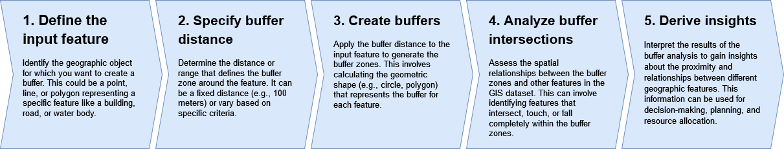
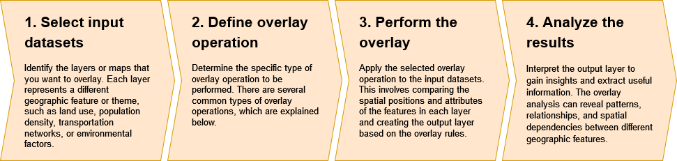

### Fundamentals of Geographic Information Systems (GIS)

# Theory 4: Spatial Operations

*By Rowan van der Kaaden*

Spatial operations take spatial data, use a geometry function to analyse the data, and produce new outputs derived from this analysis. This section will go over some common spatial operations. 

## Buffer analysis
GIS buffer analysis is a spatial analysis technique used to create buffers around spatial features. A buffer is a defined area around a geographic object, such as a point, line, or polygon, that represents a specific distance or range - or zones that represent the proximity to the feature. The buffer can be created by measuring a fixed distance from the object or by using other criteria, such as travel time.

[^1]

Buffer analysis is commonly used in GIS to answer questions about spatial relationships and proximity. By creating buffers around specific features, analysts can determine which other features fall within or intersect those buffers. For example, you may want to know how many schools there are within 200m of a busy road? How many shops there are within 100m of this train station? This can be helpful in various applications, including urban planning, environmental impact assessment, transportation analysis, and emergency response planning.

The **process of buffer analysis** involves the following steps:

Buffer analysis can be performed using GIS software, which provides tools and functions for creating buffers and analyzing the spatial relationships. The specific capabilities and options for buffer analysis may vary depending on the GIS software being used.

## Overlay analysis
Spatial overlay analysis, is a technique used in GIS to combine multiple spatial datasets to derive new information and gain insights about their spatial relationships. Overlay analysis involves overlaying multiple layers or maps to create a composite map that integrates the attributes and geometry of the input datasets.

The **overlay analysis process** involves the following steps:

    
Overlay analysis is a powerful tool in GIS because it allows the combination and integration of multiple datasets to generate new information and support decision-making processes. It is commonly used in various applications, such as land-use planning, environmental analysis, market research, demographic analysis, and infrastructure development. GIS software provides tools and functions to perform overlay analysis, and the specific capabilities may vary depending on the software used. You may recall having used this already in the crash course, where you overlaid boarding data with the small areas.

### Overlay operations 

[^2]
- (a) **Union**: The union operation combines all the input datasets to create a single output layer that includes the combined geometry and attributes of all features from the input layers.

- (b) **Intersection**: This operation identifies the spatial extent where the input datasets overlap or intersect. The resulting output will include only the areas that are common to all input datasets.

- (c\) **Symmetrical Difference**: This operation identifies the areas that are unique to each input dataset, including the overlapping portions.

- (d) **Identify**: Creates an output layer with the spatial extent of the input layer but includes attribute information from the overlay.

In addition to the aforementioned vector overlay methods, **other common multiple layer geoprocessing options** are available to the user. These included the clip, erase, and split tools.

- (e) **Clip**: Used to extract those features from an input point, line, or polygon layer that falls within the spatial extent of the clip layer.

- (f) **Erase**: Whereas the clip tool preserves areas within an input layer, the erase tool preserves only those areas outside the extent of the erase layer.
	- Note: This tool is called "Difference" in QGIS

- (g) **Split**: Used to divide an input layer into two or more layers based on a split layer.

(Hungry for more? Check out this in-detail description of Multiple Layer Analysis: https://saylordotorg.github.io/text_essentials-of-geographic-information-systems/s11-02-multiple-layer-analysis.html)

### Geometric predicates
Geometric predicates are functions used to determine the spatial relation a feature has with another by comparing whether and how their geometries share a portion of space. They are often part of the options when doing overlay analysis, don't be hesitant to come back to this section when you run into them. 

[^3]
Using the figure above, we are looking for the green circles by spatially comparing them to the orange rectangle feature. Available geometric predicates are[^3]:

- **Intersect**: Tests whether a geometry intersects another. Returns 1 (true) if the geometries spatially intersect (share any portion of space - overlap or touch) and 0 if they don’t. In the picture above, this will return circles 1, 2 and 3.

- **Contain**: Returns 1 (true) if and only if no points of b lie in the exterior of a, and at least one point of the interior of b lies in the interior of a. In the picture, no circle is returned, but the rectangle would be if you would look for it the other way around, as it contains circle 1 completely. This is the opposite of _are within_.

- **Disjoint**: Returns 1 (true) if the geometries do not share any portion of space (no overlap, not touching). Only circle 4 is returned.

- **Equal**: Returns 1 (true) if and only if geometries are exactly the same. No circles will be returned.

- **Touch**: Tests whether a geometry touches another. Returns 1 (true) if the geometries have at least one point in common, but their interiors do not intersect. Only circle 3 is returned.

- **Overlap**: Tests whether a geometry overlaps another. Returns 1 (true) if the geometries share space, are of the same dimension, but are not completely contained by each other. Only circle 2 is returned.

- **Are within**: Tests whether a geometry is within another. Returns 1 (true) if geometry a is completely inside geometry b. Only circle 1 is returned.

- **Cross**: Returns 1 (true) if the supplied geometries have some, but not all, interior points in common and the actual crossing is of a lower dimension than the highest supplied geometry. For example, a line crossing a polygon will cross as a line (true). Two lines crossing will cross as a point (true). Two polygons cross as a polygon (false). In the picture, no circles will be returned.

# Time to get your hands dirty! Move on to the [4th exercise](https://github.com/Tampere-University-Urban-Physics/fundamentals-of-gis/blob/master/Content/4_Exercise.md) to apply this new knowledge

[^1]:http://gsp.humboldt.edu/olm/Lessons/GIS/06%20Vector%20Analysis%20Attributes/001_IntroOverlayAndBuffer21.html
[^2]: https://saylordotorg.github.io/text_essentials-of-geographic-information-systems/s11-02-multiple-layer-analysis.html
[^3]: https://docs.qgis.org/3.28/en/docs/user_manual/processing_algs/algs_include.html

<!--stackedit_data:
eyJkaXNjdXNzaW9ucyI6eyJoQkYxeWFLNW1KVlpvdm1NIjp7In
N0YXJ0IjozMzIsImVuZCI6NDMxLCJ0ZXh0IjoiR0lTIGJ1ZmZl
ciBhbmFseXNpcyBpcyBhIHNwYXRpYWwgYW5hbHlzaXMgdGVjaG
5pcXVlIHVzZWQgdG8gY3JlYXRlIGJ1ZmZlcnMgYXJvdeKApiJ9
LCJEcVlxb1JxWUJCNnNHZk1FIjp7InN0YXJ0Ijo3NDUsImVuZC
I6ODU1LCJ0ZXh0IjoiIVtdKGh0dHA6Ly9nc3AuaHVtYm9sZHQu
ZWR1L29sbS9MZXNzb25zL0dJUy8wNiUyMFZlY3RvciUyMEFuYW
x5c2lzJTIwQXR0cmlidXRlc+KApiJ9LCJJSU1xajVQcGJFTnZG
OUFUIjp7InN0YXJ0IjoxMDkwLCJlbmQiOjE0MDAsInRleHQiOi
JGb3IgZXhhbXBsZSwgeW91IG1heSB3YW50IHRvIGtub3cgaG93
IG1hbnkgc2Nob29scyB0aGVyZSBhcmUgd2l0aGluIDIwMG0gb2
YgYSBi4oCmIn0sInQ4R0U1NGdJRno0d0xJcjAiOnsic3RhcnQi
OjI2MjgsImVuZCI6Mjc5NCwidGV4dCI6Ikl0IGlzIGNvbW1vbm
x5IHVzZWQgaW4gdmFyaW91cyBhcHBsaWNhdGlvbnMsIHN1Y2gg
YXMgbGFuZC11c2UgcGxhbm5pbmcsIGVudmlyb27igKYifX0sIm
NvbW1lbnRzIjp7IndNWG1iTHlqRkdxRVlsR00iOnsiZGlzY3Vz
c2lvbklkIjoiaEJGMXlhSzVtSlZab3ZtTSIsInN1YiI6ImdoOj
QwMzA0Nzg4IiwidGV4dCI6IlRoaXMgZXhwbGFpbnMgYW4gb3Bl
cmF0aW9uIHRoYXQgaXMgcGFydCBvZiB0aGUgYW5hbHlzaXMsIG
5vdCB0aGUgYW5hbHlzaXMuIFJld3JpdGUgdGhpcy4iLCJjcmVh
dGVkIjoxNzk0MjIyODU2MzEzfSwiTFlGWkxhemo4SENLRW5yei
I6eyJkaXNjdXNzaW9uSWQiOiJEcVlxb1JxWUJCNnNHZk1FIiwi
c3ViIjoiZ2g6NDAzMDQ3ODgiLCJ0ZXh0IjoiSG9zdCB0aGlzIG
91cnNlbHZlcyIsImNyZWF0ZWQiOjE3OTQyMjI5ODE3NjJ9LCJZ
M0psS3AwR2VVQWQ3Uk9GIjp7ImRpc2N1c3Npb25JZCI6IklJTX
FqNVBwYkVOdkY5QVQiLCJzdWIiOiJnaDo0MDMwNDc4OCIsInRl
eHQiOiJUaGlzIGNvbWJpbmVzIGJ1ZmZlciBhbmQgb3ZlcmxheS
BhbmFseXNpcywgbWFrZSB0aGF0IGNvbm5lY3Rpb24iLCJjcmVh
dGVkIjoxNzk0MjIzMDU2NDEwfSwiS3VRbURXMGpLU2RJUEdyUS
I6eyJkaXNjdXNzaW9uSWQiOiJ0OEdFNTRnSUZ6NHdMSXIwIiwi
c3ViIjoiZ2g6NDAzMDQ3ODgiLCJ0ZXh0IjoiQWRkIHNvbWUgcm
VhbCB3b3JsZCBleGFtcGxlcy4iLCJjcmVhdGVkIjoxNzk0MjIz
MjA1MTc4fX0sImhpc3RvcnkiOls4Njc3ODA5ODQsLTEyMTA2Nj
U5NTksNTk1NTQzODA3LC0xODYxNjczMTA2XX0=
-->