### Fundamentals of Geographic Information Systems (GIS)

# Exercise 5: Modelling optimal cultivation areas

*Updated by Rowan van der Kaaden* 

## OVERVIEW & PURPOSE
The aim of this GIS exercise is to get you familiar with working with raster data. The purpose of this GIS exercise is to classify the study area based on its suitability for cultivation, specifically considering factors such as water bodies, slope, and soil types. By integrating and analyzing these spatial datasets, we aim to assess the agricultural potential of the study area. Understanding the suitability for cultivation is crucial for effective land management, optimizing agricultural practices, and making informed decisions related to agricultural development.

Studying an area for its suitability for cultivation provides valuable insights and information for various reasons:

1.  **Optimize agricultural productivity**: Assessing the suitability of an area for cultivation allows farmers, landowners, and agricultural planners to identify the most productive areas for agricultural activities. By considering factors such as water bodies, slope, and soil types, it is possible to determine areas that have favorable conditions for crop growth, irrigation, and drainage. This optimization can lead to increased agricultural productivity and improved crop yields.
    
2.  **Sustainable land management**: Understanding the suitability of an area for cultivation supports sustainable land management practices. By analyzing factors such as slope and soil types, it becomes possible to identify areas prone to erosion, soil degradation, or nutrient deficiencies. This knowledge enables the implementation of appropriate soil conservation measures, land use planning strategies, and soil improvement techniques to ensure long-term agricultural sustainability.
    
3.  **Water resource management**: Considering water bodies as a factor in the suitability analysis helps in effective water resource management for agriculture. Identifying areas with adequate access to water bodies allows for optimized irrigation planning and utilization of water resources. It ensures efficient water use and reduces the risk of water scarcity or over-irrigation, contributing to sustainable agricultural practices.
    
4.  **Site selection for specific crops**: The suitability analysis provides insights into the specific requirements of different crops and their compatibility with the study area's conditions. By considering factors such as soil types and water availability, it becomes possible to identify areas that are well-suited for particular crops. This information aids in making informed decisions about crop selection, optimizing yield potential, and diversifying agricultural production.
    
5.  **Land use planning and decision-making**: Assessing the suitability for cultivation plays a crucial role in land use planning and decision-making processes. It provides a scientific basis for identifying areas where agricultural development can be prioritized, allocating resources efficiently, and making informed decisions about land use. This information is valuable for policymakers, land managers, and stakeholders involved in agricultural development, rural planning, and food security initiatives.

Studying an area for its suitability for cultivation is essential for optimizing agricultural productivity, promoting sustainable land management practices, ensuring efficient water resource management, selecting appropriate crop choices, and supporting informed decision-making in land use planning and agricultural development. The integration of water bodies, slope, and soil types in this GIS exercise provides a comprehensive assessment of the study area's suitability, facilitating effective agricultural planning and resource allocation.

## OBJECTIVES
The main objective of this exercise is to model optimal cultivation areas using raster data analyses in Muurla, which is a district of Salo, a city between Turku and Helsinki.

## DATA USED

- Digital Elevation Model from the National Land Survey: https://paituli.csc.fi/download.html
- Water bodies of our study area
- Soil types of our study area

## Completion

Complete the exercise and submit a short report containing at least the following:

1. Maps of the outcome of the exercise

	- Remember: all maps should have a legend, a scale bar and a north arrow

	- Use the tips from the Crash Course to improve your map

2. A short reflection (200-300 words) on this exercise and your map

## EXERCISE PHASES

### Part 1: Getting familiar with raster data
This exercise focuses mainly on raster data and raster analysis. You have already gotten used to working with vector data, but even though the world of raster might feel slightly complicated at first, it is just as simple as with vector when you get accustomed to it.

#### 1.1: Getting to know the digital elevation model

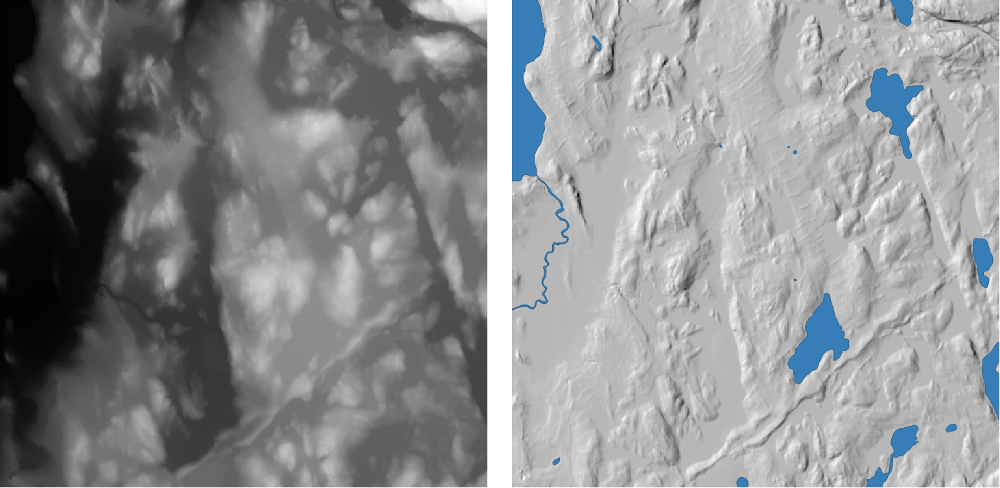

1. Download 5_Exercise_data.zip from the [Github repository](https://github.com/Tampere-University-Urban-Physics/fundamentals-of-gis/tree/master/Data), save it in a folder for this exercise, and extract the contents from the zip. 

2. You have to download the Digital Elevation Model (DEM) from PaITuli. 
	- Open the following link: https://paituli.csc.fi/download 
	- Select the following settings:
		- Producer: National Land Survey of Finland
		- Data: Elevation Model
		- Scale: 10 m x 10 m
	- Type "L3343" in the search bar
		- You might have to change the mode from "Move" to "Select map sheets".
	- Download as zip file, think about where to save this. 

3. Add the Digital Elevation Model you downloaded from PaITuli to QGIS (What type of data is this? How do you add that?).
	- The DEM is a large raster image file and thus rather heavy to process. To make the program run smoother, let's clip the DEM to a smaller extent (Remember what clipping is from the previous theory?)
		- Our study area for this exercise is the same as the Muurla_Frame -layer, so we can use this for the clipping extent.
		- Since we are clipping a raster, we need to use the *Clip raster by mask layer* tool, open this from the *Processing Toolbox*
		- Set the input layer to your DEM and the mask layer ot Muurla_Frame
		- Click run
			- Make the temporary layer permanent by right-clicking the layer and *Export* > *Save as...* (Temporary raster layers don't have the "Make permanent" option)
			- You can remove the temporary layer
		- You should now have the DEM only for the Muurla_Frame, you can remove or hide the original full-size DEM

*Reminder: Don't forget to give your files and layers informative names and save them in a folder for this exercise*

4. Before we can use the DEM, we need to fill its sinks
	- If you didn't already watch the video on why filling sinks is important, it might be a good idea to do it now to understand what you will be doing (https://www.youtube.com/watch?v=6rcx4OwnryI)
	- Open the *Fill sinks (Wang & Liu)* tool (Remember where we search for all our tools? You may also need to look for a SAGA plugin)
	- Choose the clipped DEM as the DEM, leave the rest as default
	- Run the tool, you can remove the flow directions and watershed basins outputs, save the Filled DEM
	- The output of this will be the DEM we will be using from now on! 
	- Remember to save your temporary layers to prevent data loss! 

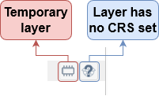

5. One of the important features of DEM is that it can be used to create a hillshade relief. Hillshade is mostly used in visualization to create an imposing 3D-effect of the surface. Let's create a hillshade using this DEM. 
	- Open the *Hillshade* tool 
	- Choose the filled DEM as the Elevation layer
	- Try out how the hillshade turns out with the default settings. You can change the result by adjusting these default values for azimuth and vertical angle. Basically, this adjusts from which angle the light hits the ground.
	- Choose settings that you think are good and make that layer permanent, you can remove your test layers

*Tip: Again, name the files! Good name for the first Hillshade could be for example “HillShade_Muurla_def” or “HS_Muurla_def” indicating that it’s a hillshade, study area and default settings – for the next one you could change the name to for example “HS_Muurla_Az180” and so on, based on the chosen settings.*

6. Another very useful feature of a DEM is the possibility to identify the gradient of the raster surface. 
	- Open the *Slope* tool
	- Use the filled DEM again, you can use the default settings 

**Answer the following questions on Moodle:**

- What is the maximum slope of the study area based on the DEM10m_Muurla?
- How about the mean slope of the study area based on the DEM10m_Muurla?

**Hint**: *Layer Properties contain information about the layers, including some statistics)*

#### 1.2: Data type conversions - feature to raster
It is quite common in GIS that data has to be converted from one type to another; some analyses for instance require a certain file type to work. In part two of this exercise you are going to need to convert the vector shapefile “Muurla_Soil.shp” to a raster file to be able to perform the raster overlay analyses.

7. Let's convert the Muurla_Soil.shp to a raster file
	- Open the *Rasterize (Vector to Raster)* tool
	- Use the Muurla_soil layer as the input
	- Since rasters can’t have multiple attributes like shapefiles we need to select which field to use. Column “PINTA” has the information which we want to use for the analysis, so this is the column you should select for “Field to use for a burn-in value” -parameter. 
	- Set the size units to Georeferenced units, and the resolution to the same as the resolution of the DEM
	- Run the tool
	- Don't forget to make your layer permanent

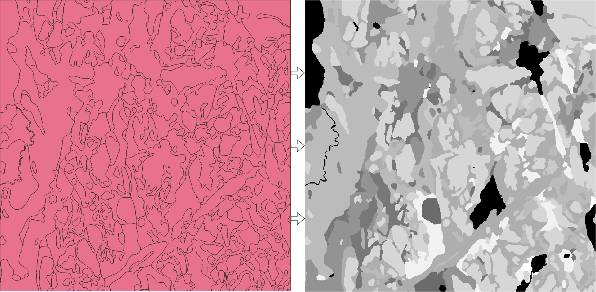

---

### 2: Calculating the optimal cultivation areas

Southwest Finland is sometimes called as the bread-basket of Finland, which refers to its plentiful fields and agricultural productivity. In this exercise your task is to model optimal cultivation areas using raster data analyses in Muurla.

The aim is to classify the study area based on its suitability for cultivation. The criteria are the following:

- Good or moderate soil
- Slope < 15°
- Minimum distance of 10m from the bodies of water
- The soil factor is twice as important as the slope factor

In the earlier phase you already clipped the DEM, filled the DEM, calculated the slope and made the feature to raster conversion for the soil so some phases are already done. The following flow chart shows the different stages of the optimal cultivation areas analysis.

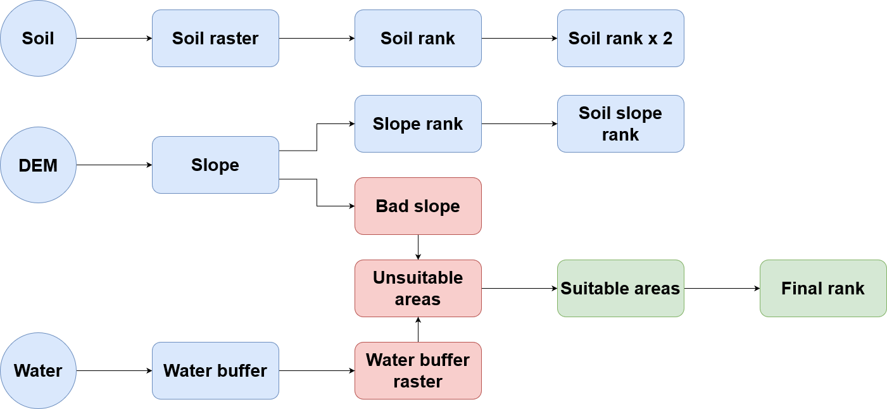

#### 2.1: Defining the unsuitable areas

8. Start off with the water criteria. Use the Buffer -tool to make a 10-meter buffer for the Bodies_of_Water -layer without dissolving. (Hint: Exercise 4)

9. Next, you have to convert the newly created buffer zone -layer to raster format. As learned before in this practical, use the *Rasterize (Vector to Raster)* tool to make this rasterization. Choose “Pinta” as the field to assign the values to the output raster and check that the cell size matches the DEM again.

10.  For further calculations we need to reclassify the data of the water buffer raster layer. Here, reclassifying means that we give the locations with water bodies the value of 0, meaning that those areas are not suitable for the cultivation purposes.
		- Open the *Reclassify by table* tool
		- Add the reclassification table as pictured below.  
		- Run the tool and save the output

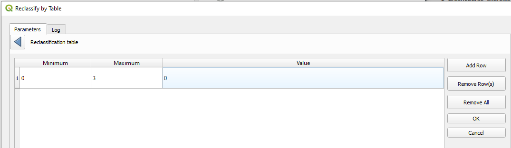

11. Let’s continue with defining the unsuitable areas by determining the “bad slopes”. 
	- Use the *Reclassify by table* tool again, choose this time the slope raster as the input
	- Add the reclassification table as pictured below
		- What do you think the 1 and 0 values represent in this analysis?
	- Run the tool and save the output

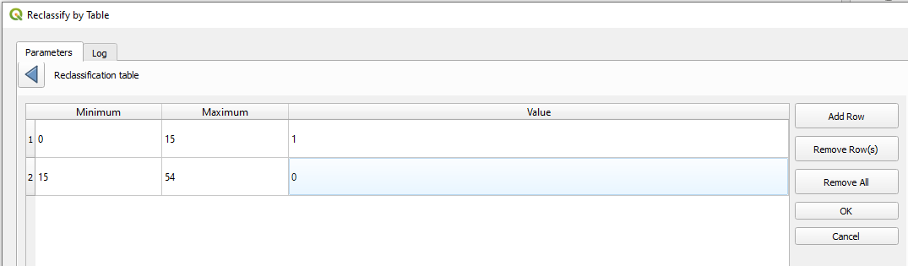

The “water buffer” and the “bad slopes” will be classified as “0” so that they can be removed from the calculations later on with multiplication.

12. Now let’s combine the bad criteria layers
	- Open the *Merge* tool from the *Processing Toolbox* (GDAL > Raster micellaneous > Merge) 
	- Select the reclassified water layer and reclassified slope layer as input layers, leave the rest on default
	- As you will notice, the output has a border around it with the value 0. This is because the merge tool used the extent of the largest layer, which is the water bodies because we added a 10m buffer to this. This is outside our study area, so we need to clip this to the Muurla_Frame again. Use the instructions given earlier to do this and save the clipped result for the next steps. 

The unsuitable areas:
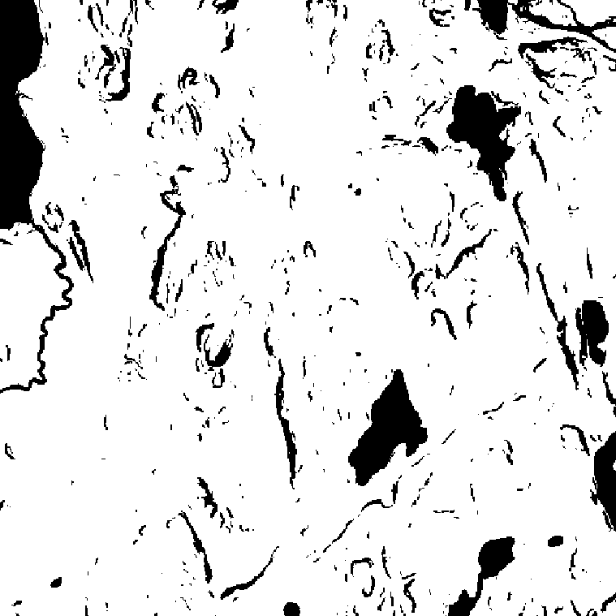

#### 2.2: Defining the suitable areas

13. Now after you have identified the unsuitable areas, your next task is to rank the suitable ones.
	- To make the “slope rank” go once again to *Reclassify by table*
	- Choose the original Slope_Muurla file as the input raster
	- Add the reclassification table as pictured below

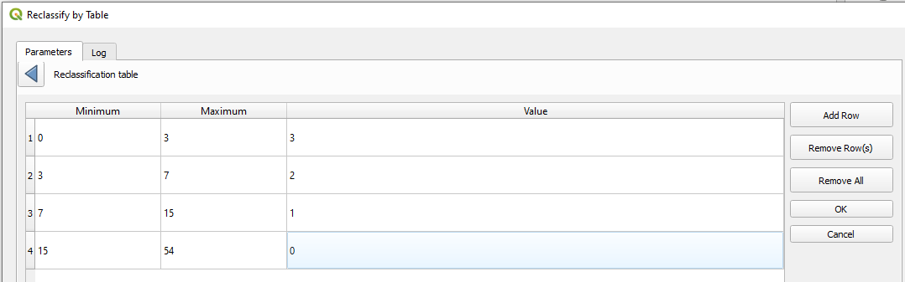

Let’s move on to ranking the soil. You can see the explanation for the soil codes below.

| No. | Soil type |
|--|--|
| 3 | Water |
| 4 | Ballast |
| 11 | Sphagnum peat |
| 12 | Coarse sand |
| 13 | Silt |
| 14 | Medium sand |
| 15 | Gravelly till |
| 16 | Sandy till |
| 17 | Clay |
| 18 | Fine sand |
| 19 | Rock |
| 21 | Sedge peat |
| 22 | Muddy silt |

14. Open the *Reclassify by table* tool, use the soil raster we converted earlier (from step 7) and specify the values as in the figure below. The higher the value the better the soil fits for cultivation.
	- This time set the *Range boundaries* under *Advanced Parameters* on "min <= value <= max", why do you think this is necessary? (hint: <= means less than or equal to")

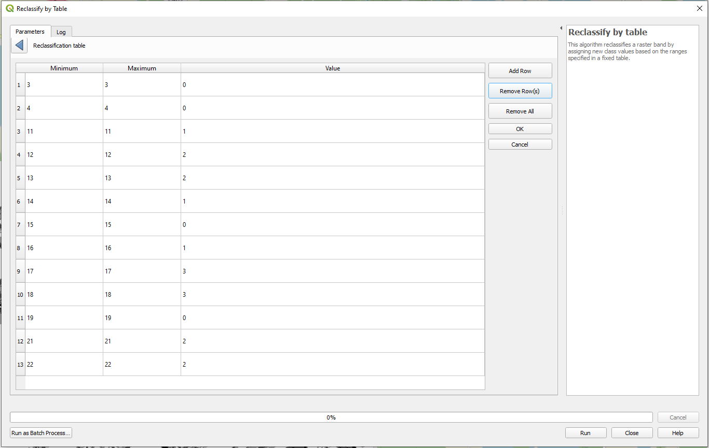

***Note**: for simplicity, we did not identify an ‘unsuitable_soil’ layer but only the soil_rank, i.e. areas with soil type as rock will show a low suitability, but they will not be identified as completely unsuitable if they e.g. are located in a suitable slope pixel. This is ok for the purpose of the exercise, but it is good to keep it in mind. As an optional task, you can add them to unsuitable areas and make another analysis as well.*

#### 2.3: Identifying the final suitability ranking

15. In the last part we will use all the components created to get the suitability map. 
	- Open the *Raster calculator*
	- Use the expression from the figure below, don't forget to adjust the names of the layers to correspond to yours
		- unsuitable_merged_clipped = result from step 12
		- slope_ranking = result from step 13
		- soil_ranking_reclassified = result from step 14
	- Set the reference layer to the original filled DEM layer (why do you think this reference is necessary?)
	- Run the calculation and save the output

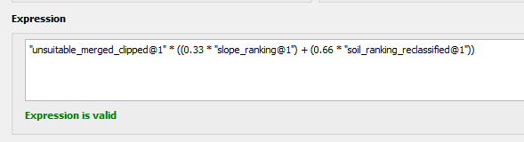

16. Open once more *Reclassify by table* and select the result from step 15 layer as the input. Reclassify the layer so to have 4 classes so that one represents unsuitable values (0) and others have interval of 1 (with rank values 0, 1, 2, 3, see the figure below)

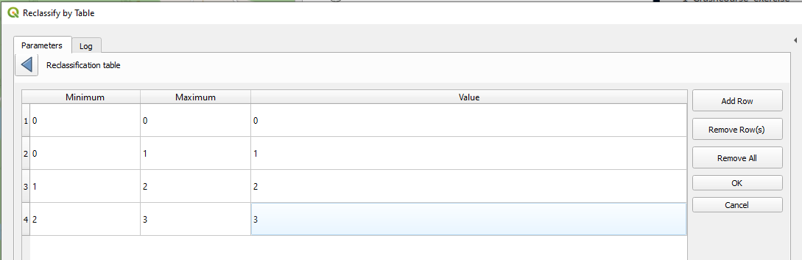

17. Now, you should see the optimal cultivation areas in the study area. You can add a basemap from XYZ tiles or QMS  and see whether your optimal areas match with the real fields located in the area.

---

### Part 3: Map visualization time

For suitability analysis it’s common to make a map collection showing the criteria areas and the final suitability analysis map. Make maps with following rasters:

• Soil types
• Terrain (hill shade)
• Slopes with unsuitable gradient areas highlighted
• Water bodies (can be combined to terrain or slopes)
• Final suitability analysis map (final rank)

Visualize the rasters as desired (hint: you can change the symbology of raster layers as well. Think about whether this should be continuous values, or whether using a categorical symbology would be better). For this type of maps base maps are in general not used. Feel free to include any additional map visualizations.

As your final task, write a short reflection on what was done and why and add it also to your report.

**Don’t forget to add map items for all maps.**

*Tip: Find inspiration for visualization by googling “suitability map cultivating”, “soil type map colors”, and so on.*
<!--stackedit_data:
eyJkaXNjdXNzaW9ucyI6eyI4dUdpZEh2bllqcDFERE5kIjp7In
RleHQiOiIjIyMjIDIuMjogRGVmaW5pbmcgdGhlIHN1aXRhYmxl
IGFyZWFzIiwic3RhcnQiOjEyOTI3LCJlbmQiOjEyOTY0fSwiUW
xCWXU0dGw4dEtmMlJ6QiI6eyJzdGFydCI6MTA5LCJlbmQiOjE0
MiwidGV4dCI6IipVcGRhdGVkIGJ5IFJvd2FuIHZhbiBkZXIgS2
FhZGVuKiJ9LCJLTW1BdlFURk03MGd5clQxIjp7InN0YXJ0Ijox
NjcsImVuZCI6MjgyLCJ0ZXh0IjoiVGhlIGFpbSBvZiB0aGlzIE
dJUyBleGVyY2lzZSBpcyB0byBnZXQgeW91IGZhbWlsaWFyIHdp
dGggd29ya2luZyB3aXRoIHJhc3RlciBkYeKApiJ9LCJ1OTVBS0
F6b2czc256aWdKIjp7InN0YXJ0IjoyODMsImVuZCI6MzgyOCwi
dGV4dCI6ImlzIHRvIGNsYXNzaWZ5IHRoZSBzdHVkeSBhcmVhIG
Jhc2VkIG9uIGl0cyBzdWl0YWJpbGl0eSBmb3IgY3VsdGl2YXRp
b24sIHNwZWNpZmnigKYifSwiZmd0ejZoVGdoM0RqYVBScSI6ey
JzdGFydCI6OTcyNywiZW5kIjo5NzMyLCJ0ZXh0IjoiUElOVEEi
fSwiRlRZNTd3MDM4b2h4YVlIMSI6eyJzdGFydCI6MTEwNDAsIm
VuZCI6MTExODYsInRleHQiOiIhW10oaHR0cHM6Ly9yYXcuZ2l0
aHVidXNlcmNvbnRlbnQuY29tL1RhbXBlcmUtVW5pdmVyc2l0eS
1VcmJhbi1QaHlzaWNzL2Z1bmRhbWVu4oCmIn19LCJjb21tZW50
cyI6eyJ5dlhjdFRPNnZuVkNMbzREIjp7ImRpc2N1c3Npb25JZC
I6Ijh1R2lkSHZuWWpwMURETmQiLCJzdWIiOiJnaDo0MDMwNDc4
OCIsInRleHQiOiJGcm9tIGhlcmUgaXQgY291bGQgYmUgbWFkZS
BvcHRpb25hbC9hbm90aGVyIGV4ZXJjaXNlIiwiY3JlYXRlZCI6
MTY4NzI0NzYyNTc3OH0sIlNrSHZVQkc0ZDZFS1JEQ00iOnsiZG
lzY3Vzc2lvbklkIjoiUWxCWXU0dGw4dEtmMlJ6QiIsInN1YiI6
ImdoOjQwMzA0Nzg4IiwidGV4dCI6IkFkZCBjcmVkaXRzIHRvIG
9yaWdpbmFsIGF1dGhvcnMiLCJjcmVhdGVkIjoxNzk0Mjk3NTc4
NzY5fSwiOWFzTU9YMlJHYWRGbkkwMCI6eyJkaXNjdXNzaW9uSW
QiOiJLTW1BdlFURk03MGd5clQxIiwic3ViIjoiZ2g6NDAzMDQ3
ODgiLCJ0ZXh0IjoiSW1wcm92ZSB0aGlzIHNlbnRlbmNlIiwiY3
JlYXRlZCI6MTc5NDI5NzYwMTAyOX0sIkdNb3NlZHdlcnlncXJz
SU8iOnsiZGlzY3Vzc2lvbklkIjoidTk1QUtBem9nM3NuemlnSi
IsInN1YiI6ImdoOjQwMzA0Nzg4IiwidGV4dCI6IlRoaXMgaXMg
dmVyeSByZXBldGl0aXZlIGFuZCBsb25nLCBJIHRoaW5rIGl0IG
NvdWxkIGJlIGEgbG90IG1vcmUgY29uY2lzZSB3aXRob3V0IGxv
c2luZyBhbnkgaW5mb3JtYXRpb24uIiwiY3JlYXRlZCI6MTc5ND
I5Nzc1MzcyN30sImNUd1BvbTZneXQ5eVB4WkYiOnsiZGlzY3Vz
c2lvbklkIjoiZmd0ejZoVGdoM0RqYVBScSIsInN1YiI6ImdoOj
QwMzA0Nzg4IiwidGV4dCI6IkV4cGxhaW4gd2hhdCB0aGlzIGZp
ZWxkIGlzLiIsImNyZWF0ZWQiOjE3OTQyOTkxMDc5MDN9LCJNT0
Y0aWRRMzBDOXN0MVB6Ijp7ImRpc2N1c3Npb25JZCI6ImZndHo2
aFRnaDNEamFQUnEiLCJzdWIiOiJnaDo0MDMwNDc4OCIsInRleH
QiOiJPciBhc2sgdGhlbSB0byB0aGluayBvZiBpdD8iLCJjcmVh
dGVkIjoxNzk0Mjk5MTE1Mjc3fSwiaWlFVjdwc0tZcHc3UFJaWi
I6eyJkaXNjdXNzaW9uSWQiOiJGVFk1N3cwMzhvaHhhWUgxIiwi
c3ViIjoiZ2g6NDAzMDQ3ODgiLCJ0ZXh0IjoiVGhpcyBncmFwaC
BoYXMgc29tZSBlcnJvcnMsIG5lZWRzIHRvIGJlIHJlbWFkZS4i
LCJjcmVhdGVkIjoxNzk0Mjk5Mjk2MDkxfX0sImhpc3RvcnkiOl
sxNzUwNjcyMDA0LDE3NTA2NzIwMDQsLTMzNjE1NTE4NywtMTQw
Nzg1MTUyMCw2MTE1OTY0NywyMjU1MDg3MDIsMTI3MzYxMTE5LD
Y2NDg5ODg5OCwxMzE4NzUzODksLTUyMjY4MzY3LDU5ODU3ODE2
NywyMDA5NDY1MzU4LDE3MTAwNDQ0MzksLTEwMTM2MDQxMiw1Mz
g0MzA3NjAsMTg3NDY5MTk4NCwtNzYxNjI0MDQwLDE1ODI1Nzcz
NzQsOTIyODUwOTY3LDEyODg5OTk4NDZdfQ==
-->