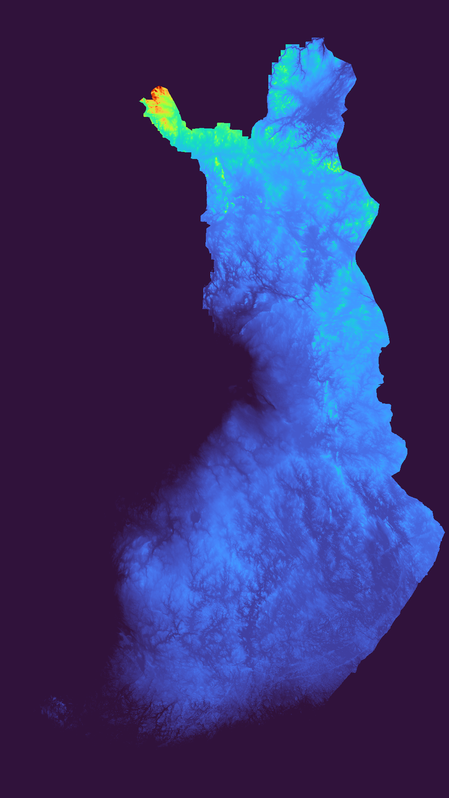
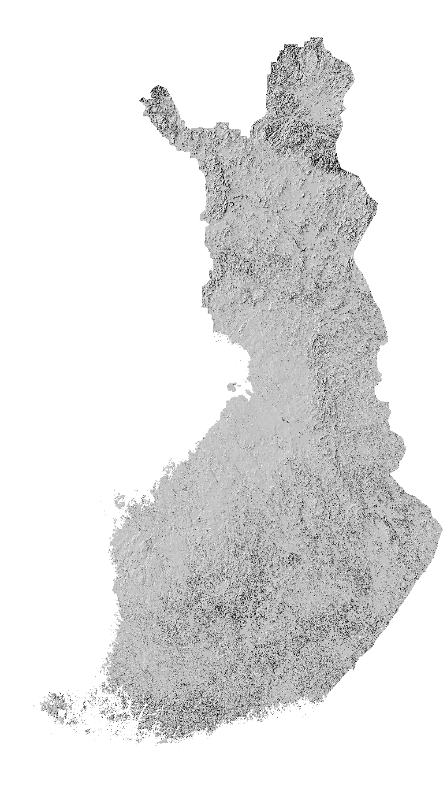

### Fundamentals of Geographic Information Systems (GIS)

# Theory 5: Digital Elevation Model, Hillshade, and raster overlay analysis

*By Rowan van der Kaaden*

Let's get back to rasters. As discussed before, rasters are gridded data where each pixel/grid represents some information. We can think of aerial photographs as rasters, where each pixel of the photo tells us the colour of the ground. Or, maybe the pixels tells us the height of the ground, or some kind of climate variable like temperatures. Rasters represent the field view, where the geographical space (each pixel) is filled with some value.

## Digital Elevation Model (DEM)
There are various ways to represent three dimensional surfaces in GIS, including contour maps (which you may have seen before) and Digital Elevation Models. A Digital Elevation Model (DEM) is a three-dimensional representation of the Earth's surface that is created using elevation data. It is a digital representation of the topography of a particular area, typically displayed as a grid of elevation values. 

DEM data is collected using various methods, including remote sensing techniques such as LiDAR (Light Detection and Ranging), radar, or photogrammetry. These methods involve sending out signals or capturing images from different perspectives to measure the height of the Earth's surface at specific points.

The resulting elevation data is then processed and interpolated to create a continuous representation of the terrain. The grid of elevation values in a DEM is often represented as a raster dataset, where each cell or pixel contains the elevation information for that location.

DEM data has numerous applications in various fields, including geography, geology, environmental science, urban planning, and engineering. It is used for visualizing and analyzing terrain characteristics, mapping landforms, identifying slopes and aspect, hydrological modeling, determining visibility and line of sight, and more. DEMs are essential in creating accurate maps, conducting terrain analysis, and supporting decision-making processes in numerous industries and research domains. 

DEMs are often used as a generic term for Digital Surface Models (DSMs) and Digital Terrain Models (DTMs). A DSM represents the elevation of the earth's surface and all the objects on it. For example, a city would have a variable DSM that shows the changes in heights due to buildings. In contrast, a DTM model represents the ground without any objects on it.

### Sinks
Filling sinks in a DEM is an important preprocessing step that addresses a common issue in elevation data. A sink refers to a depression or low-lying area in the terrain where water can accumulate, such as a small basin or a closed contour. When sinks are present in a DEM, they can introduce inaccuracies and create problems in subsequent analyses or applications. 

The process of filling sinks typically involves identifying the depressions or sinks in the DEM and modifying the elevation values within those areas to ensure a continuous and realistic representation of the terrain. This can be done using various algorithms or techniques, such as the breaching or filling algorithms, which raise the elevation of the sinks until they reach the surrounding terrain level. By filling sinks, the DEM becomes more suitable for accurate and reliable analysis and visualization of the terrain.

(Want to learn more about why and when filling sinks in necessary? Check videos such as: https://www.youtube.com/watch?v=6rcx4OwnryI)

### Hillshade
The hillshade technique is a method used to create a shaded relief representation of a DEM or terrain surface. It simulates the effects of lighting on the terrain to enhance the visual perception of the three-dimensional characteristics of the landscape. The resulting hillshade image provides a sense of depth and helps to emphasize the topographic features of the terrain.

The hillshade technique calculates the illumination and shadows on the terrain surface based on the direction of the light source, the elevation values of the DEM, and the slope and aspect of each pixel. 

The hillshade technique is widely used in cartography, geospatial analysis, and visualization applications. It helps in understanding the topography of an area, identifying landforms, visualizing slopes and ridges, and enhancing the aesthetics of terrain maps.

### Slope
A DEM provides the necessary data to perform slope analysis. With a DEM, you can calculate and analyze the slope of the terrain at various locations. Slope analysis allows you to understand the steepness of the landscape, identify areas of high or low slope, and assess the terrain characteristics for various applications.

Slope analysis using a DEM is valuable in a range of applications, including terrain characterization, land management, environmental assessment, and infrastructure planning. It provides insights into the topographic features of the landscape, supporting decision-making processes and aiding in understanding the terrain's behavior and suitability for various purposes.

### Contours
When looking at a topological map, you may also have come across maps that have contours. Contours are another way of visualizing slope (using vectors), with lines which represent similar elevations. The closeness of the contour lines provide an idea of areas with gradual and rapid slope changes, as well as peaks and valleys.

## Raster  analysis
Just like with vectors, we can do analyses and calculations with rasters. Raster analysis is a fundamental geospatial analysis technique in GIS that involves combining and analyzing multiple raster layers to derive new information or gain insights into the relationships between different spatial datasets. It enables you to perform complex operations by overlaying and integrating raster datasets, pixel by pixel, to generate output layers with new attributes or identify areas that meet specific criteria. In QGIS, the Raster Calculator tool is commonly used to male calculations on rasters.

In raster analysis, each raster layer is composed of a grid of cells or pixels, with each cell containing a value representing a specific attribute or measurement. When overlaying two or more raster layers, the values of the corresponding cells are compared and combined based on predefined rules or operations. The most common operations used in raster overlay analysis include:

1.  **Overlay operations**: These operations combine two or more raster layers to create a new output layer. Examples of overlay operations include:
    
    -   *Union*: Combines the values of overlapping cells from multiple layers, often used to identify areas of overlap or convergence.
    -   *Intersection*: Retains only the values of cells where all input layers have non-zero values, useful for identifying areas that satisfy multiple conditions.
    -   *Difference*: Compares the values of cells between layers and outputs the difference or change.

2.  **Mathematical operations**: These operations perform mathematical calculations on the values of corresponding cells in different layers. Common mathematical operations include addition, subtraction, multiplication, division, and statistical calculations like mean, median, or standard deviation.
    
3.  **Boolean operations**: These operations utilize Boolean logic (AND, OR, NOT) to determine the presence or absence of certain conditions or attributes. They help create binary or categorical output layers based on specified criteria. They can also be used to reclassify raster data.

Raster analysis is used in various GIS applications, such as land suitability analysis, environmental modeling, habitat analysis, urban planning, and natural resource management. It allows for the integration of diverse datasets, including DEMs, satellite imagery, land cover maps, and thematic data, to generate valuable information and support decision-making processes. By overlaying and combining raster layers, you can explore spatial relationships, identify patterns, quantify spatial characteristics, and derive meaningful insights from the data.

# Time to get your hands dirty! Move on to the [5th exercise](https://github.com/Tampere-University-Urban-Physics/fundamentals-of-gis/blob/master/Content/5_Exercise.md) to apply this new knowledge
<!--stackedit_data:
eyJkaXNjdXNzaW9ucyI6eyJRYmU0dGF0bkVJcTZ3N0dCIjp7In
RleHQiOiJhbmQgRCIsInN0YXJ0IjozMjMsImVuZCI6MzI4fSwi
Q2lZUzZ6NW93cGk3eXdOZiI6eyJzdGFydCI6MTc4MiwiZW5kIj
oyMjczLCJ0ZXh0IjoiREVNIGRhdGEgaGFzIG51bWVyb3VzIGFw
cGxpY2F0aW9ucyBpbiB2YXJpb3VzIGZpZWxkcywgaW5jbHVkaW
5nIGdlb2dyYXBoeSwgZ2VvbOKApiJ9LCJQTVF0dG1nT25kdWt6
SUdjIjp7InN0YXJ0IjoyNjM3LCJlbmQiOjI2NDYsInRleHQiOi
IjIyMgU2lua3MifSwiWk5mR0NDRkt4SWdhTnExRyI6eyJzdGFy
dCI6NTAxMywiZW5kIjo1MzgyLCJ0ZXh0IjoiU2xvcGUgYW5hbH
lzaXMgdXNpbmcgYSBERU0gaXMgdmFsdWFibGUgaW4gYSByYW5n
ZSBvZiBhcHBsaWNhdGlvbnMsIGluY2x1ZGluZyB0ZeKApiJ9LC
JxTFV3czF2NjdLZUM1S1lGIjp7InN0YXJ0Ijo0Njc4LCJlbmQi
OjQ2ODcsInRleHQiOiIjIyMgU2xvcGUifSwiMm1KMDF1NnpOVU
M3VzNMSiI6eyJzdGFydCI6NTM4NCwiZW5kIjo1Mzk2LCJ0ZXh0
IjoiIyMjIENvbnRvdXJzIn0sInIyVGdLUXNKbTFkSjI3ejYiOn
sic3RhcnQiOjY3MjIsImVuZCI6Nzg3NCwidGV4dCI6IjEuICAq
Kk92ZXJsYXkgb3BlcmF0aW9ucyoqOiBUaGVzZSBvcGVyYXRpb2
5zIGNvbWJpbmUgdHdvIG9yIG1vcmUgcmFzdGVyIGxheWVyc+KA
piJ9fSwiY29tbWVudHMiOnsiMmNpRXNLRTBiR2J5WDQ1TyI6ey
JkaXNjdXNzaW9uSWQiOiJRYmU0dGF0bkVJcTZ3N0dCIiwic3Vi
IjoiZ2g6MjIxNjgxNTciLCJ0ZXh0IjoiY291bGQgbWVudGlvbi
BUSU4gYW5kIG90aGVycyB0b28sIEkgZ3Vlc3MsIGJ1dCBtYXli
ZSB0aGlzIG1ha2VzIGl0IHRvbyBjb21wbGljYXRlZC5cblxuVG
hlIHBvaW50IGlzIHRvIG1ha2Ugc3R1ZGVudHMgcmVhbGlzZSB0
aGF0IHRoZXJlIGlzIG1vcmUgdGhhbiBvbmUuXG5cbkNvdWxkIG
Fsc28gY29uc2lkZXIgdGFsa2luZyBhYm91dCB0aGUgZGlmZmVy
ZW5jZXMgYmV0d2VlbiBEaWdpdGFsIEVsZXZhdGlvbiBNb2RlbC
wgRGlnaXRhbCBUZXJyYWluIE1vZGVsLCBEaWdpdGFsIFN1cmZh
Y2UgTW9kZWwuLi4iLCJjcmVhdGVkIjoxNjg4MDMzNjY2NTE5fS
wicG9qVzJYQ0lvQ2k1Qms5TSI6eyJkaXNjdXNzaW9uSWQiOiJD
aVlTNno1b3dwaTd5d05mIiwic3ViIjoiZ2g6NDAzMDQ3ODgiLC
J0ZXh0IjoiQWRkIHNvbWUgcmVhbCB3b3JsZCBleGFtcGxlcy4i
LCJjcmVhdGVkIjoxNzk0Mjk2OTgzMzA2fSwiQnRneVdOYjRyd2
VDajNHUCI6eyJkaXNjdXNzaW9uSWQiOiJQTVF0dG1nT25kdWt6
SUdjIiwic3ViIjoiZ2g6NDAzMDQ3ODgiLCJ0ZXh0IjoiQWRkIG
EgdmlzdWFsIGV4YW1wbGUiLCJjcmVhdGVkIjoxNzk0Mjk3MTc0
MTg5fSwiNjhHQ0thTkJUZFhsSDE5QiI6eyJkaXNjdXNzaW9uSW
QiOiJaTmZHQ0NGS3hJZ2FOcTFHIiwic3ViIjoiZ2g6NDAzMDQ3
ODgiLCJ0ZXh0IjoiQWRkIHJlYWwgbGlmZSBleGFtcGxlIiwiY3
JlYXRlZCI6MTc5NDI5NzI1OTg3NX0sImJNcmd3OWZmUEYwRjBo
aXMiOnsiZGlzY3Vzc2lvbklkIjoicUxVd3MxdjY3S2VDNUtZRi
IsInN1YiI6ImdoOjQwMzA0Nzg4IiwidGV4dCI6IkFkZCB2aXN1
YWwiLCJjcmVhdGVkIjoxNzk0Mjk3MjY0NzU4fSwiQnZJV1lsen
hPaGpSOVdKWiI6eyJkaXNjdXNzaW9uSWQiOiJaTmZHQ0NGS3hJ
Z2FOcTFHIiwic3ViIjoiZ2g6NDAzMDQ3ODgiLCJ0ZXh0Ijoid2
l0aCBwaWN0dXJlcyIsImNyZWF0ZWQiOjE3OTQyOTcyNzI0NzF9
LCI5SXVydjFHcnhNUjBPUVY4Ijp7ImRpc2N1c3Npb25JZCI6Ij
JtSjAxdTZ6TlVDN1czTEoiLCJzdWIiOiJnaDo0MDMwNDc4OCIs
InRleHQiOiJBZGQgZXhhbXBsZSB2aXN1YWwiLCJjcmVhdGVkIj
oxNzk0Mjk3MjgxNTg1fSwiMWp4Tm5DcW93ZFpmNU5mdSI6eyJk
aXNjdXNzaW9uSWQiOiJyMlRnS1FzSm0xZEoyN3o2Iiwic3ViIj
oiZ2g6NDAzMDQ3ODgiLCJ0ZXh0IjoiQWRkIHJlYWwgbGlmZSBl
eGFtcGxlcyBhbmQgdmlzdWFsIGV4YW1wbGVzIGZvciBlYWNoIG
9mIHRoZXNlLiIsImNyZWF0ZWQiOjE3OTQyOTc0MTY0MTF9fSwi
aGlzdG9yeSI6Wy0yNTIzNzI5NzQsLTEzMDk5NDA0NDgsNjU4OD
M1MDQsMTQxNDkyNTg5MywxMzgzNDc0MjA1LDY5MjczMzIyOCwx
MjA4NDAwMjAxLDExMjczNzU1MTksLTE5NDY3NzU0NjEsMTgwOT
A1NjcsMjAxNDEyNzExNywtODg1MjkwMzMzLC04OTYyMjcyODEs
OTk0NzIwMTkzLC0zNTEwNzY1ODAsLTEzOTAzMzIwNTFdfQ==
-->